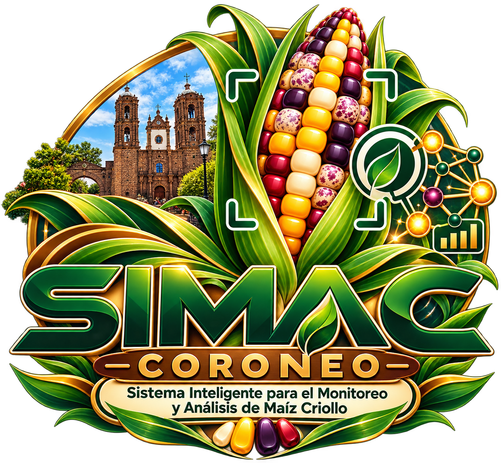
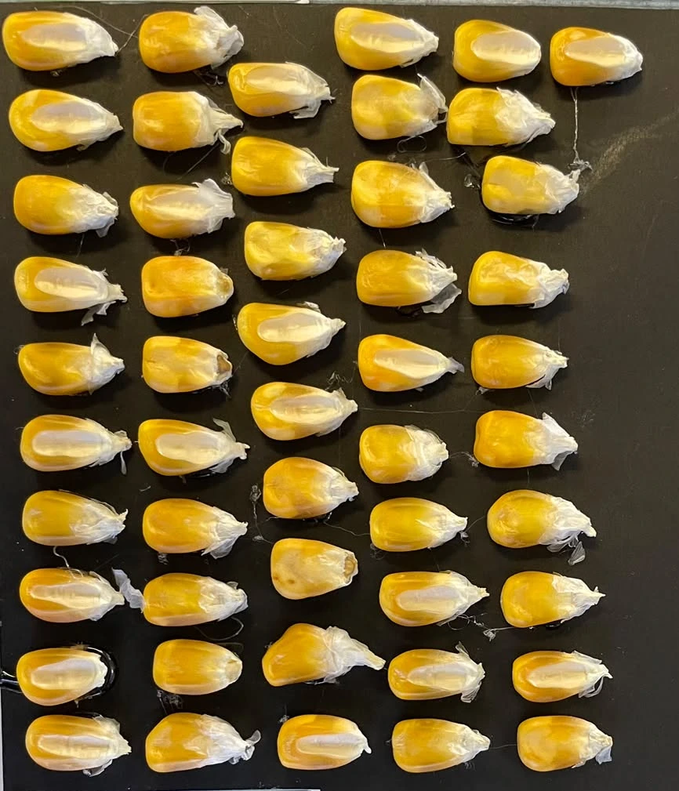
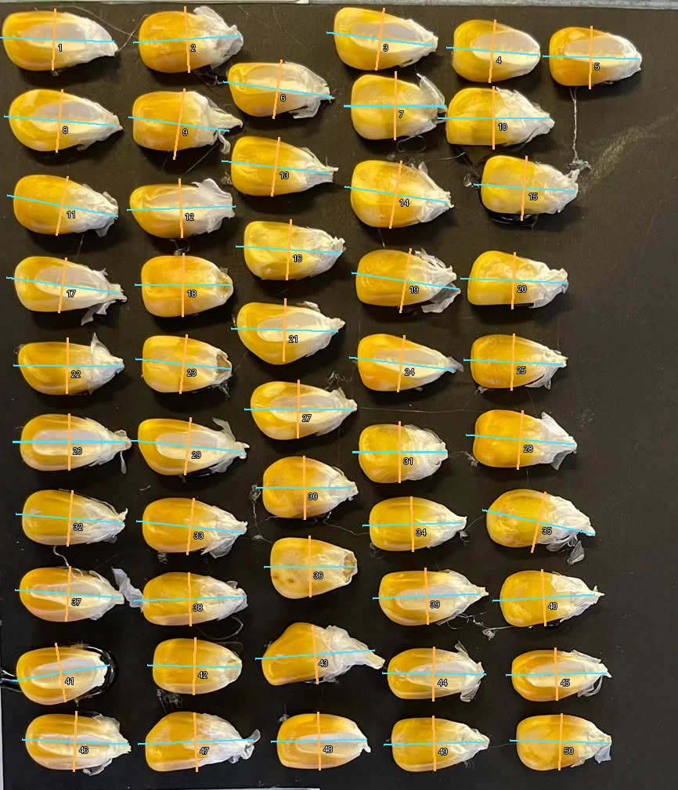

<p align="center">
  
</p>

<h1 align="center">SIMAC Coroneo</h1>

<p align="center"><strong>Sistema Inteligente para el Monitoreo y Análisis de Maíz Criollo</strong></p>
<p align="center">Análisis de imágenes y registro de muestras de maíz de Coroneo y su región.</p>

<p align="center">
  
  
  
  
  
</p>

<p align="center">
  <a href="#funciones-actuales">Funciones</a> ·
  <a href="#requisitos-e-instalación">Instalación</a> ·
  <a href="#fotografías-y-siete-pruebas">Evidencias</a> ·
  <a href="#limitaciones-y-mejoras-futuras">Alcance</a> ·
  <a href="#equipo-y-reconocimientos">Equipo y créditos</a>
</p>

Proyecto desarrollado durante **TrackTalents ITESI 2026**, con participación del equipo de **CECyTE Guanajuato, Unidad Académica Coroneo**, a partir de una base de investigación de **ITESI y la Universidad Autónoma Agraria Antonio Narro (UAAAN)**.

SIMAC es una aplicación web para analizar fotografías de granos, revisar detecciones, obtener medidas y organizar registros agrícolas.

## Vista del análisis

Ejemplo de la galería guardada de SIMAC-001. Estas imágenes permiten comparar la fotografía, la segmentación y la visualización de dimensiones; corresponden a una ejecución guardada, no a un procesamiento en vivo.

<p align="center">
  
  
  
</p>

**Flujo de trabajo:** fotografía → recorte y calibración → segmentación → revisión → resultados e informe.

## Guía para revisar el proyecto

| Qué revisar | Dónde encontrarlo |
|---|---|
| Ejecutar SIMAC en una computadora | [Instalación](#requisitos-e-instalación) y ejecución del backend y frontend |
| Integración de Cellpose | [backend/analysis.py](backend/analysis.py) |
| API e historial de muestras | [backend/main.py](backend/main.py) |
| Interfaz del laboratorio | [src/main.tsx](src/main.tsx) |
| Fotografías de las siete pruebas | [muestras/](muestras/) |
| Informes HTML y PDF | [reportes/](reportes/) |
| Colección de 80 fotografías | [public/Visual/](public/Visual/) |
| Variables, peso y clasificación experimental | [PESO_Y_SVM.md](PESO_Y_SVM.md) |

La aplicación se ejecuta siguiendo las instrucciones de este README. El repositorio permite consultar y descargar el código; no es un sitio de análisis alojado en GitHub Pages. La descarga de la base y los modelos grandes requiere **Git LFS**.

## Problema y objetivo

La colecta de maíces de distintas comunidades produce fotografías, fichas y mediciones que deben conservar una relación clara con cada muestra. Contar granos y organizar sus características manualmente requiere tiempo y puede introducir errores de registro.

El objetivo es facilitar el conteo y la caracterización de granos mediante imágenes, conservar su procedencia y reunir datos verificables para estudiar los maíces de la región. El equipo reporta 80 muestras de aproximadamente 42 localidades de Coroneo y zonas cercanas de Jerécuaro, Huimilpan y Epitacio Huerta. La cobertura de colecta no constituye una clasificación genética ni una validación agronómica.

## Funciones actuales

- Cargar JPG, PNG o WebP hasta 25 MB, desde archivos o cámara compatible.
- Recortar granos sueltos y calibrar una distancia real en milímetros con dos puntos.
- Segmentar con Cellpose/cyto3 o mediante umbral automático clásico.
- Revisar contornos, excluir objetos, unir detecciones compatibles y confirmar el conteo.
- Consultar largo, ancho, área, perímetro, forma y color por grano.
- Estimar peso con su referencia y registrar pesajes reales de conjuntos identificados.
- Guardar muestras e historial y descargar CSV, vistas e informes HTML que se pueden imprimir o guardar como PDF.
- Registrar materiales, familias, parcelas, observaciones y cruzamientos; importar y exportar CSV.
- Entrenar y activar versiones experimentales de clasificación Alto/Bajo y evaluar modelos de peso con datos suficientes.
- Explorar resultados guardados y un archivo visual de 80 fotografías; las copias de galería no se sincronizan automáticamente con el historial.
- Consultar Elotín como guía local y, opcionalmente, como asistente mediante Groq.

## Tecnologías

| Componente | Tecnologías |
|---|---|
| Interfaz | React 19, TypeScript, Vite 6, CSS y Lucide React |
| API | Python 3.12, FastAPI, Uvicorn y python-multipart |
| Imágenes | Cellpose 3.1.1.2/cyto3, PyTorch, scikit-image y Pillow |
| Cálculo y modelos | NumPy y scikit-learn: SVM, regresión logística, Ridge, escalado y selección de variables |
| Persistencia e intercambio | SQLite, JSON, CSV y openpyxl |
| Elotín | Groq, modelo configurado openai/gpt-oss-20b y guía local |
| PWA | Manifest, iconos y página de aviso sin conexión |
| Verificación | unittest y compilación TypeScript/Vite |

JavaScript se instala con `package.json` y `package-lock.json`. Python se declara en `backend/requirements.txt`; `backend/requirements-lock.txt` registra versiones del entorno revisado para facilitar su reproducción en Windows, sin garantizar compatibilidad universal con todas las plataformas y GPU.

## Estructura

```text
SIMAC-Coroneo/
├── backend/                 API, análisis, modelos, requisitos y pruebas
├── data/                    Historial y modelos de demostración; binarios grandes con Git LFS
├── dist/                    Copia compilada de la aplicación
├── src/                     Interfaz y generación de informes
├── public/                  Recursos web, galerías, iconos y PWA
│   └── Visual/              80 fotografías y catálogo de identificación
├── muestras/                Siete fotografías de evidencia y procedencia
├── reportes/                Informes HTML y PDF de las siete pruebas
├── notebooks/               Transcripciones S3/S4; revisar permiso de redistribución
├── docs/                    Manifiesto de integridad de datos y modelos
├── scripts/                 Comprobación de recursos y archivos de Git
├── .env.example             Ejemplo sin credenciales
├── .gitignore
├── package.json
├── package-lock.json
├── iniciar-backend.ps1
├── configurar-elotin.ps1
├── permitir-wifi.ps1
├── PESO_Y_SVM.md
└── README.md
```

Se incluyen los 15 archivos de demostración existentes de `data/`, mediante una lista explícita en `.gitignore`, y `dist/` como copia compilada. SQLite y pesos grandes usan **Git LFS**. Quedan fuera `.env`, entornos virtuales, `node_modules/`, cachés y `tmp/`; los archivos nuevos de datos no revisados siguen ignorados. Hacer un respaldo antes de mover o reinstalar la aplicación. No es necesario borrar archivos locales para excluirlos de Git.

## Requisitos e instalación

Git y **Git LFS**, Node.js 22, npm, Python 3.12 y pip. Los scripts incluidos usan Windows y PowerShell; en otros sistemas pueden ejecutarse los comandos equivalentes de Python, npm y Uvicorn. Se puede trabajar con CPU; Cellpose aprovecha una GPU compatible con PyTorch cuando está disponible.

Se necesita internet para descargar dependencias y, en el primer uso de Cellpose, sus pesos si no están instalados. El chat con IA necesita además una cuenta API válida.

Descarga el repositorio con Git y Git LFS. El ZIP de GitHub puede no incluir los archivos grandes completos:

```powershell
git clone https://github.com/nacho23-tc/SIMAC-Coroneo.git
cd SIMAC-Coroneo
git lfs install --local
git lfs pull
python scripts/verificar_recursos.py
```

La comprobación debe encontrar 15 recursos correctos antes del primer inicio. Los archivos de 100-200 bytes que empiezan con `version https://git-lfs.github.com/spec/v1` son punteros, no los modelos ni la base completos. Git LFS depende del acceso y la cuota del repositorio. No sobrescribir datos de una instalación ya utilizada para repetir esta comprobación.

Desde la raíz:

```powershell
npm ci
python -m venv .venv-cellpose
.\.venv-cellpose\Scripts\python.exe -m pip install --upgrade pip
.\.venv-cellpose\Scripts\python.exe -m pip install -r backend/requirements-lock.txt
if (-not (Test-Path .env)) { Copy-Item .env.example .env }
```

Si la plataforma no admite alguna versión del bloqueo, resolver dependencias con `backend/requirements.txt` y volver a ejecutar las pruebas. Esto puede cambiar versiones y no garantiza compatibilidad con modelos serializados anteriores. No sobrescribir un `.env` existente sin conservar su configuración privada.

### Ejecutar el backend

Primera terminal, desde la raíz:

```powershell
.\iniciar-backend.ps1
```

Equivalente:

```powershell
.\.venv-cellpose\Scripts\python.exe -m uvicorn backend.main:app --host 127.0.0.1 --port 8000 --reload --reload-dir backend
```

API: `http://127.0.0.1:8000`. Documentación: `http://127.0.0.1:8000/docs`. La base se crea al usar las funciones de persistencia.

### Ejecutar el frontend

Segunda terminal:

```powershell
npm run dev
```

Abrir `http://127.0.0.1:5173/`. Vite redirige `/api` al backend local. El acceso al laboratorio es de demostración y sus datos aparecen en la pantalla de entrada: no constituye autenticación real para internet.

Para tableta, conectar ambos dispositivos al mismo Wi-Fi y usar la URL local del footer; al pulsarla se intenta copiar. La computadora y ambos servidores deben permanecer encendidos. Si Windows bloquea el acceso, revisar el firewall. `permitir-wifi.ps1` requiere permisos de administrador y una ruta a Node que coincida con su instalación. No hace falta exponer el puerto 8000.

### Configurar Elotín

La guía local no necesita clave. Para IA, usar `.env`:

```dotenv
GROQ_API_KEY=
GROQ_MODEL=openai/gpt-oss-20b
```

Pegar la clave únicamente en el equipo. `configurar-elotin.ps1` permite introducirla de forma oculta. Las variables del servidor tienen prioridad sobre `.env`. Nunca usar un nombre `VITE_` para una clave: se incorporaría al cliente.

El usuario activa la IA explícitamente. El backend envía a Groq la pregunta y hasta seis mensajes recientes, sin adjuntar fotografías ni registros privados. Los botones rápidos usan la guía local; también se utiliza como respaldo ante errores, falta de configuración o límites. Las cuotas y condiciones dependen del proveedor. Elotín orienta; no mide granos ni entrena modelos agrícolas.

## Análisis de imágenes y modelos

**Segmentación:** Cellpose usa `cyto3`, un modelo generalista preentrenado, no una red entrenada desde cero por el equipo. Se incluyen `data/models/cyto3` y `data/models/size_cyto3.npy` mediante Git LFS. Si faltan, esta versión de Cellpose intenta descargarlos de `https://www.cellpose.org/models/cyto3` y `https://www.cellpose.org/models/size_cyto3.npy`. Con los dos archivos completos y las dependencias instaladas no necesita descargarlos de nuevo. Si no están disponibles y no hay acceso a la descarga, seleccionar explícitamente el método clásico. Los contornos y la calibración deben revisarse; sin referencia física, las medidas son píxeles.

**Peso:** se distingue entre referencia bibliográfica, referencia pesada del lote, peso real del conjunto exacto declarado por el usuario y modelos Ridge disponibles. La referencia publicada procede de cinco variedades estudiadas en Maharashtra; no es una medición de Coroneo ni un intervalo de confianza local.

**Clasificación:** se comparan SVM y regresión logística con escalado y selección de variables, usando imagen, metadatos o ambos. El modelo activo se carga sin repetir el entrenamiento. La evaluación histórica del curso obtuvo **2 aciertos de 4 familias reservadas**: no demuestra predicción confiable del rendimiento regional. La distancia SVM no es una probabilidad.

**Registro agrícola:** conserva mediciones reales y permite calcular rendimiento observado con cosecha y superficie. Guardar datos no reentrena automáticamente; registrar una cruza no acredita su realización ni su evaluación.

Los detalles de variables, particiones, comprobaciones y fuentes están en [PESO_Y_SVM.md](PESO_Y_SVM.md).

### Recursos de demostración incluidos

Los archivos de datos y modelos incluidos se identifican en `docs/RECURSOS_DEMOSTRACION.json`. Los scripts usan este manifiesto para comprobar que la descarga está completa:

- `data/samples.sqlite3`: historial real, fotografías y registros agrícolas disponibles, con Git LFS.
- `data/metadata.json`: catálogo asociado.
- `data/yield_models/`: modelos `.joblib` mediante LFS, manifiestos y selección `active.json`.
- `data/yield_experiments/`: evidencias de entrenamiento.
- `data/course_weight.json`, `data/course_training.json` y los dos archivos de `data/training_sources/`.
- `data/models/cyto3` y `size_cyto3.npy`: pesos de segmentación y estimación de tamaño, mediante LFS.

No se creó una base de ejemplo ni se inventaron muestras. Si se instala sin `data/`, la interfaz y el método clásico pueden funcionar, la persistencia crea una base vacía y Elotín conserva la guía local. No aparecerán el historial original ni los modelos de clasificación y peso. La galería estática seguirá mostrando las copias de evidencia incluidas en `public/`.

Los modelos entrenados SVM y Ridge del proyecto **no se descargan automáticamente** de una API: vienen de estos archivos locales. Los `.joblib` deben proceder de una fuente confiable y requieren bibliotecas compatibles. No activar modelos de otras procedencias para sustituir los faltantes. Los datos incluidos contienen información real y deben revisarse junto con los derechos de terceros antes de hacer público el repositorio.

## Fotografías y siete pruebas

`public/Visual/` contiene 80 fotografías originales. El archivo recibido como `SIMAC-78.jpeg` muestra SIMAC-080 en la ficha; el catálogo lo distingue de SIMAC-078. SIMAC-065 fue confirmado por el equipo ante una discrepancia en la etiqueta. La galería se abre en `/Visual/` o directamente desde su `index.html`.

`muestras/` contiene siete copias verificadas de SIMAC-001 a SIMAC-007. `reportes/` contiene siete informes HTML y siete PDF originales, más el PDF adicional SIMAC-002-VER2. Todos se copiaron sin alterar resultados. Los PDF conservan encabezados con rutas del equipo y algunos corresponden a versiones anteriores al HTML; los manifiestos distinguen su procedencia. Los HTML pueden abrirse sin servidor e imprimirse como PDF. Sus manifiestos identifican procedencia y hashes. Son evidencias de ejecución, no ensayos independientes de validación agrícola.

El informe SIMAC-002-VER2 tiene escala en mm y 50 detecciones, pero conserva el estado «sin confirmar». No se alteró para aparentar revisión. Las cifras del informe y de la galería pueden corresponder a versiones guardadas en distintos momentos; no deben combinarse como una sola ejecución.

Las siete fotografías de evidencia se cotejaron con los registros de la base. Los PDF de referencia del reporte suman 372 detecciones: para SIMAC-002 se utiliza `SIMAC-002-VER2.pdf`. Este total describe las pruebas documentadas y no representa una precisión medida.

## Verificación y despliegue

```powershell
npm run build
.\.venv-cellpose\Scripts\python.exe -B -m unittest discover -s backend/tests -v
.\.venv-cellpose\Scripts\python.exe -B scripts/verificar_entrega.py
```

Las pruebas de software son distintas de las muestras recolectadas. La auditoría comprueba los archivos candidatos de Git, los recursos y las evidencias, y busca credenciales sin mostrar sus valores. El resultado se guarda localmente en `tmp/entrega/INVENTARIO_PUBLICACION.json`, fuera de Git. Esta comprobación automática se complementa con la revisión de fotografías y fichas.

`dist/` conserva una compilación verificada y se puede regenerar con `npm run build`; no sustituye al backend ni a sus datos. No se suben las dependencias instaladas: `npm ci` las reconstruye. GitHub aloja código. **GitHub Pages por sí solo no ejecuta FastAPI, Cellpose ni SQLite.** Un despliegue público necesita backend, HTTPS, configuración de `/api`, autenticación real, permisos de acceso, persistencia y control del gasto de API. La PWA incluye una página de aviso sin conexión, no análisis completo offline.

## Limitaciones y mejoras futuras

- No hay predicción regional validada de toneladas por hectárea, altura, floración o adaptación a partir de una foto de granos.
- Una fotografía no certifica germinación, vigor, inocuidad ni aptitud para siembra.
- Cada imagen necesita calibración propia; iluminación, perspectiva, resolución y contornos afectan las medidas.
- Colecta, registro y entrenamiento son etapas distintas. Se necesitan respuestas reales, separación de lotes/ciclos y evaluación independiente.
- Las siguientes etapas incluyen germinación, suelo y clima, documentación de cruzamientos y modelos de adaptación y rendimiento evaluados en campo.

## Equipo y reconocimientos

Los cultivos de maíz, variables, imágenes y código fuente inicial de referencia proceden de un proyecto de investigación de **ITESI–UAAAN**. Se reconoce a:

- **ITESI:** Dr. Jorge Noé García Chávez, Dr. Juan Pablo Serrano Rubio e Ing. Sergio Ismael Torres Sánchez.
- **UAAAN:** Dra. Ana Laura Alonso Nieves.
- **CECyTE Guanajuato, Unidad Académica Coroneo:** equipo que continúa el trabajo mediante su adaptación a SIMAC y la colecta regional.
- **Asesor:** Ignacio Tinajero Camacho.
- Personas productoras y donantes, docentes, mentores y organización de TrackTalents ITESI 2026.

Responsabilidades informadas por el equipo:

| Integrante | Responsabilidad |
|---|---|
| Guadalupe Lizeth Garduño Muñoz | Capitana; coordinación, seguimiento y entregables |
| Ximena Carrillo Pérez | Integración de plataforma, funcionalidades y pruebas |
| Leslie Licea García | Organización de muestras, procedencia y fotografías |
| Alonso Pérez Gómez | Programación, imágenes, pruebas y revisión de resultados |
| Anyi Sherlin Ruiz Loyola y Cristian Uriel Rubio García | Colaboradores de apoyo, sin asignación individual documentada |
| Todo el equipo | Investigación, capacitación, documentación, colecta y presentación |

Se reconocen las bibliotecas y modelos de terceros, incluidos Cellpose/cyto3 y sus autores. Groq proporciona la inferencia de Elotín con el modelo de lenguaje de OpenAI configurado. **OpenAI Codex** se utilizó como asistencia en programación, revisión y documentación. Los créditos completos y enlaces están en «Acerca de» y `src/ProjectCredits.tsx`.

## Derechos y repositorio

No se incluye una licencia de código abierto. Los materiales de investigación, cuadernos del curso, datos, fotografías, modelos y logotipos conservan su procedencia y sus condiciones de uso. Su redistribución requiere las autorizaciones correspondientes; los créditos no sustituyen esos permisos.

Repositorio público: https://github.com/nacho23-tc/SIMAC-Coroneo.
